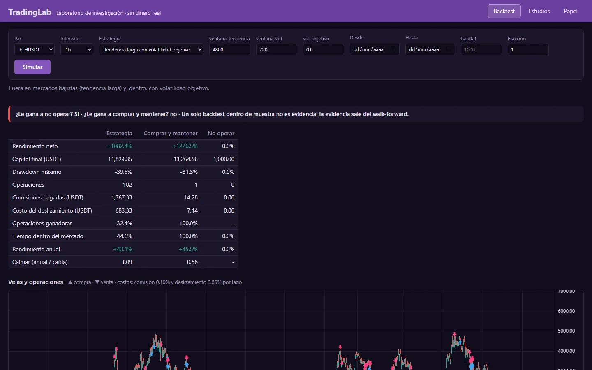
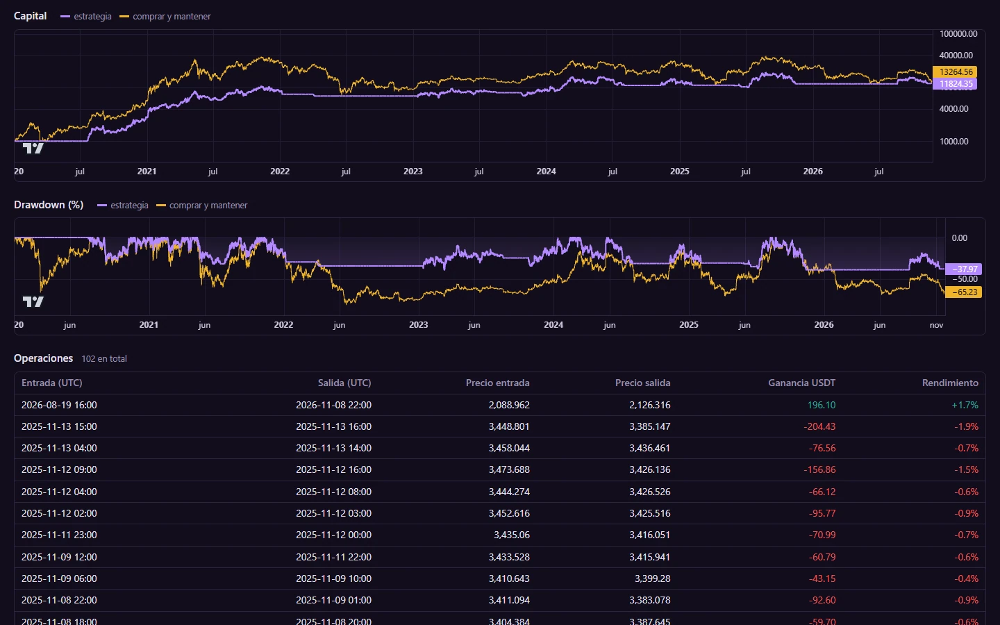
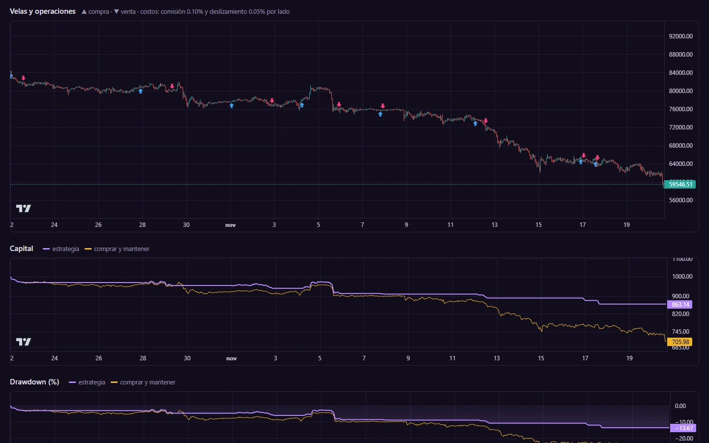
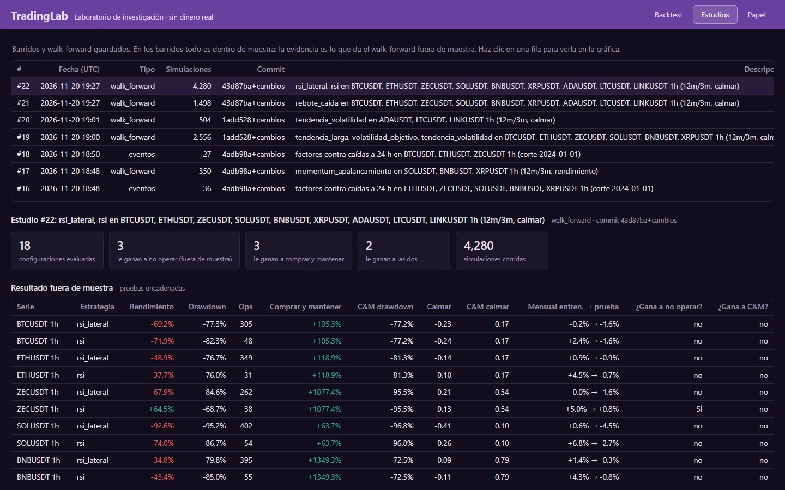
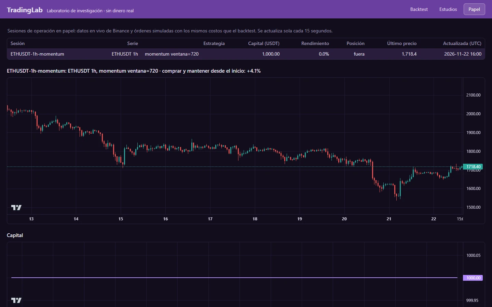

# TradingLab

Laboratorio de investigación de estrategias de trading en criptomonedas que responde, con costos reales y validación fuera de muestra, si alguna estrategia le gana a no operar y a comprar y mantener. No usa dinero real.

[](LICENSE)    



## Qué hace

- **Recolector incremental de velas:** baja velas OHLCV de Binance spot desde 2020 con la API REST pública (sin llaves) y las guarda en SQLite sin duplicados. Si se interrumpe, retoma donde se quedó. También revisa la calidad: huecos por mantenimiento, velas inválidas y que las velas de 5m cuadren con las de 1h. La primera descarga de BTC, ETH y ZEC fueron 2,353,224 velas de 5m y 1h, en 2,364 peticiones y 13.9 minutos.
- **Motor de backtest con costos reales:** cobra 0.1% de comisión y 0.05% de deslizamiento por lado (0.2% en ZEC, que es menos líquido). Decide solo con velas cerradas y ejecuta en la apertura de la siguiente. Reporta rendimiento neto, drawdown máximo, operaciones, comisiones pagadas, porcentaje de operaciones ganadoras, rendimiento anual y Calmar. Un backtest de 1h tarda unos 0.02 s.
- **Dos referencias siempre:** cada resultado se compara, en la misma ventana y con el mismo capital, contra *no operar* y contra *comprar y mantener*, que paga los mismos costos.
- **11 estrategias con pocos parámetros:** cruce de medias, ruptura de canal, RSI, momentum, momentum con filtro de apalancamiento o de sentimiento, RSI solo en mercado lateral, rebote tras caída brusca, tendencia larga, volatilidad objetivo y tendencia larga con volatilidad objetivo (con posiciones parciales).
- **Validación walk-forward y corridas masivas:** elige parámetros en un periodo y los prueba en el siguiente, que la estrategia no vio. Cada barrido, walk-forward o estudio de eventos se guarda con su configuración, su número de simulaciones y el commit de git con que se corrió. Hoy hay 17 estudios guardados, con 29,304 simulaciones.
- **Panel web** (FastAPI y TradingView Lightweight Charts): velas con las operaciones marcadas, curva de capital y drawdown contra comprar y mantener, estudios guardados y sesiones en papel.
- **Operación en papel con datos en vivo:** recibe las velas de Binance por websocket y simula las órdenes con las mismas reglas del backtest. Una prueba verifica que, con las mismas velas, el papel haga exactamente las mismas operaciones. También hay un estudio de eventos con factores externos (funding e interés abierto de futuros, índice de miedo y codicia) para ver si alguno avisa antes de las caídas fuertes.

## Principios

1. **Sin dinero real.** Solo datos públicos, sin llaves de API, y no hay código que mande órdenes a un exchange, ni siquiera desactivado.
2. **Costos reales en toda simulación.** Ningún resultado sin costos se presenta como resultado.
3. **Dos referencias siempre:** no operar, y comprar y mantener.
4. **Solo cuenta lo de fuera de muestra (walk-forward).** El mejor resultado entre muchos intentos se considera sospechoso de entrada, y cada estudio registra cuántas combinaciones probó.
5. **Hipótesis antes que resultados.** Algunos pares se reservan sin mirarlos, y cada prueba de confirmación se escribe con su criterio de éxito en [`docs/RESULTADOS.md`](docs/RESULTADOS.md) *antes* de correrla. Se reporta tal cual salga.
6. **Reproducibilidad:** cada corrida guarda sus parámetros, la ventana, los costos y el commit.

## Resultados hasta ahora

Datos de Binance spot de 2020 a noviembre de 2026, con 1,000 USDT de capital. El detalle completo está en [`docs/RESULTADOS.md`](docs/RESULTADOS.md).

- **Casi nada le gana a las dos referencias.** En el barrido inicial (3,612 simulaciones, todas dentro de muestra), solo el 4.5% le ganó a no operar y a comprar y mantener a la vez, y la mediana fue negativa en las 4 estrategias base.
- **Fuera de muestra es peor.** En el walk-forward de 2021 a 2026 (6,768 simulaciones), solo 2 de 24 configuraciones le ganaron a las dos referencias. En velas de 5m, el cruce de medias, la ruptura y el momentum perdieron entre 97% y 100% por costos. Las combinaciones que "prometían" de +3% a +7% al mes en entrenamiento dieron casi siempre entre −2% y +2% al mes en prueba.
- **La única pista no se confirmó.** Momentum en ETH 1h se probó en tres pares reservados (SOL, BNB y XRP) y le ganó a las dos referencias solo en 1 de 3. La hipótesis se rechazó.
- **Gestión de riesgo:** la tendencia larga con volatilidad objetivo tuvo caídas menores que comprar y mantener en los 9 pares probados (unos 27% menores en promedio), pero eso es una pista y no evidencia. Además, la hipótesis registrada (H4) se rechazó porque cumplió en 1 de 3 pares reservados, y las caídas siguieron siendo de 40% a 83%.
- **Mercados laterales:** usar el RSI solo cuando el mercado va de lado perdió dinero en los 9 pares fuera de muestra (de −10% a −93%). Comprar tras una caída brusca cumplió el criterio solo en 2 de 9.
- **Factores externos:** el funding, el interés abierto y el miedo y codicia no avisan de las caídas mejor que la propia volatilidad del precio, que anuncia movimientos grandes pero no su dirección.

Conclusión: con costos reales, ninguna estrategia probada le gana de forma consistente a comprar y mantener.

## Capturas

Las capturas usan datos públicos reales de Binance y capital ficticio de 1,000 USDT. No hay cuentas ni dinero real.

| | |
|---|---|
|  |  |
| Capital y drawdown de la estrategia (morado) contra comprar y mantener (amarillo) | Velas de 1h con cada compra y venta simulada |
|  |  |
| Estudios guardados con sus simulaciones y su commit; detalle del walk-forward #22 | Operación en papel de ETH/USDT con velas en vivo |

[Todas las capturas](docs/evidencia/README.md)

## Tecnologías

- Python 3.11 o más nuevo (desarrollado con 3.14; el código se mantiene compatible con 3.11 para correr en Debian 12)
- SQLite con el módulo `sqlite3` de la biblioteca estándar; configuración en `config.toml` leída con `tomllib`
- requests contra la API REST pública de Binance, sin ccxt, para conservar el número de operaciones y el volumen taker de cada vela
- pandas y NumPy para indicadores y el motor de backtest
- FastAPI, Uvicorn y TradingView Lightweight Charts 4.2.3 (JavaScript sin compilar) para el panel
- websockets para los datos en vivo
- pytest y httpx para las pruebas

## Cómo correrlo

Requisitos: Python 3.11 o más nuevo y conexión a internet para bajar los datos. No hay llaves ni variables de entorno: todo se configura en `config.toml` (pares, intervalos, fecha de inicio, costos y puerto del panel).

### Instalación en Windows (PowerShell)

```powershell
git clone https://github.com/Alexsandro215/TradingLab.git
cd TradingLab
py -m venv .venv
.venv\Scripts\Activate.ps1
python -m pip install -e ".[dev]"
```

En Linux, crea el entorno con `python3 -m venv .venv` y actívalo con `source .venv/bin/activate`. La instalación es la misma.

### 1. Crear la base de datos

La base SQLite **no viene en el repositorio**. Se genera con el recolector en `datos/tradinglab.sqlite`, carpeta que git ignora:

```powershell
python -m tradinglab descargar                                   # baja o actualiza todo lo de config.toml
python -m tradinglab descargar --simbolo ZECUSDT --intervalo 1h  # una sola serie
python -m tradinglab verificar                                   # resumen y control de calidad
```

La primera vez tarda varios minutos (BTC, ETH y ZEC en 5m y 1h son unos 14 minutos y una base de unos 250 MB), y `config.toml` también incluye pares de validación en 1h. `descargar` es incremental: se puede interrumpir y volver a correr cuando sea.

### 2. Backtests y estudios

```powershell
python -m tradinglab --help                                      # todos los comandos
python -m tradinglab estrategias                                 # estrategias, parámetros y rejillas
python -m tradinglab backtest --simbolo ETHUSDT --intervalo 1h --estrategia momentum --param ventana=168
python -m tradinglab backtest --simbolo BTCUSDT --estrategia cruce_medias --desde 2022-01-01 --hasta 2023-01-01 --operaciones 10

python -m tradinglab barrido                                     # todas las estrategias, pares, intervalos y ventanas
python -m tradinglab walk-forward                                # 12 meses de entrenamiento / 3 de prueba
python -m tradinglab walk-forward --intervalo 1h --entrenamiento 24 --prueba 6 --criterio calmar --detalle
python -m tradinglab estudios                                    # lista; `estudios 2` muestra el estudio #2
```

### 3. Panel web

```powershell
python -m tradinglab panel --abrir
```

Se abre en `http://localhost:8000`. El puerto se cambia en `config.toml` o con `--puerto`. Las direcciones `#estudios`, `#estudios/2` y `#papel` abren directo esas pestañas.

### 4. Operación en papel

```powershell
python -m tradinglab papel --simbolo ETHUSDT --intervalo 1h --estrategia momentum --param ventana=168
python -m tradinglab papel --nombre ETHUSDT-1h-momentum          # retomar una sesión
python -m tradinglab papel --listar
```

Se detiene con Ctrl+C, y la sesión se retoma con el mismo `--nombre`. Antes de conectarse, y después de cada desconexión, rellena por REST las velas que falten.

### 5. Factores externos y exploraciones

```powershell
python -m tradinglab factores                                    # funding, métricas de futuros y miedo y codicia (la primera vez ~30 min)
python -m tradinglab eventos                                     # ¿qué factor avisa antes de las caídas?
python -m tradinglab walk-forward --estrategia tendencia_volatilidad --intervalo 1h --criterio calmar
python analisis/lateral.py                                       # ¿hay rebote en los mercados laterales?
python analisis/adelanto.py                                      # ¿un mercado se adelanta a otro? (baja datos públicos de FRED)
```

## Pruebas

```powershell
python -m pytest
```

Las 96 pruebas pasan sin red, porque Binance se simula en `tests/fabrica.py`. Comprueban, entre otras cosas:

- los reintentos y los límites de peso del recolector, y que no duplique velas;
- que ninguna estrategia use datos del futuro (una prueba para cada una);
- que los costos más altos nunca mejoren el resultado;
- que el walk-forward solo cuente lo de fuera de muestra;
- que el panel responda;
- que el papel reproduzca exactamente al backtest.

## Estructura

```
config.toml          pares, intervalos, fecha de inicio, costos y puerto del panel
tradinglab/
  recolector/        cliente REST de Binance, descarga incremental y verificación de velas
  backtest/          costos, carga de series, estrategias y motor con las dos referencias
  validacion/        ventanas, barridos, walk-forward y registro de estudios con su commit
  panel/             API FastAPI de solo lectura y página con Lightweight Charts
  papel/             operación en papel y conexión en vivo por websocket
  factores/          funding, métricas de futuros, miedo y codicia, y estudio de eventos
analisis/            exploraciones reproducibles (mercados laterales, adelanto entre mercados)
docs/                HISTORIAL.md (bitácora), RESULTADOS.md (hallazgos), PLAN_FASE1.md, evidencia/
tests/               pruebas con pytest, sin red
datos/               base SQLite y datos descargados (se genera; ignorada por git)
```

Las reglas completas de la simulación y las convenciones del proyecto están en [`CLAUDE.md`](CLAUDE.md).

## Licencia

MIT. Ver [LICENSE](LICENSE).

---

Hecho por [Alexsandro Hernández Vargas (AHV-Dev)](https://github.com/Alexsandro215).
