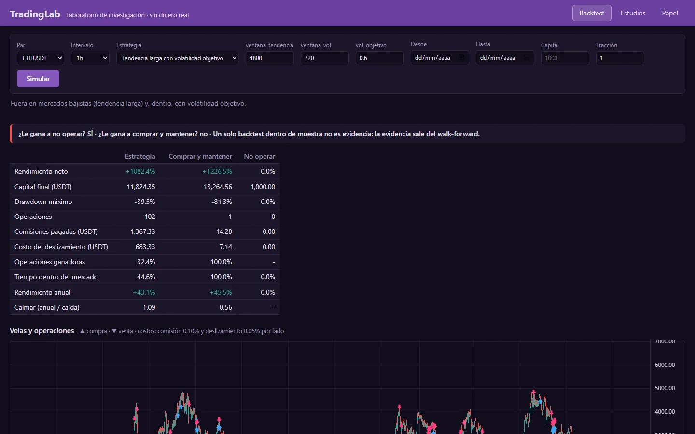
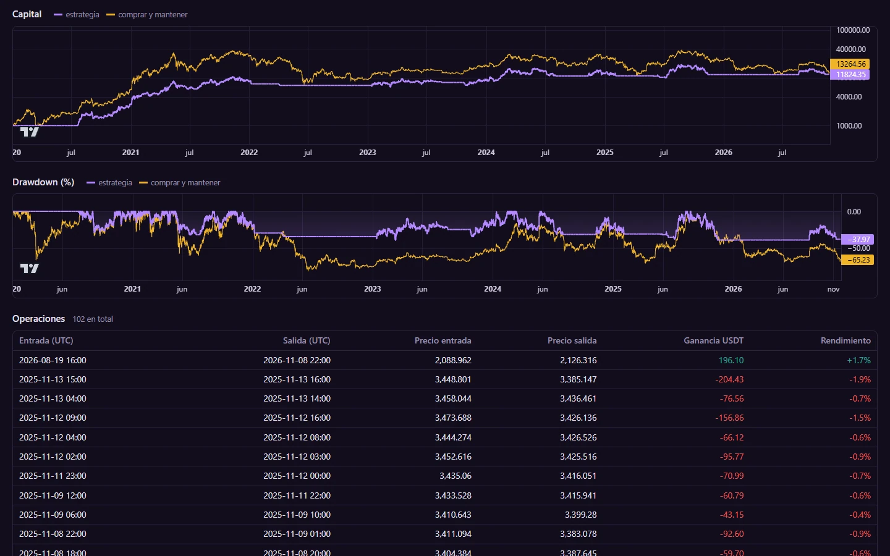
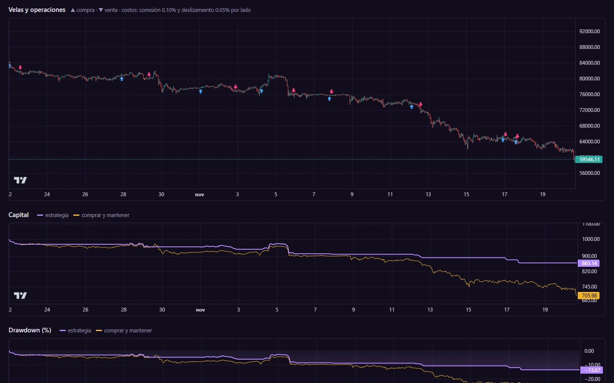
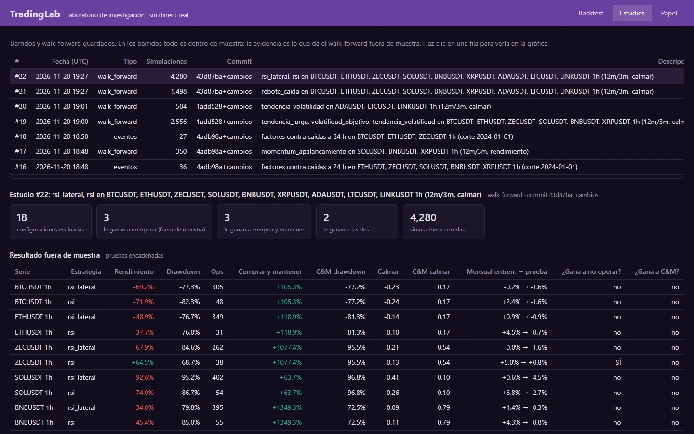
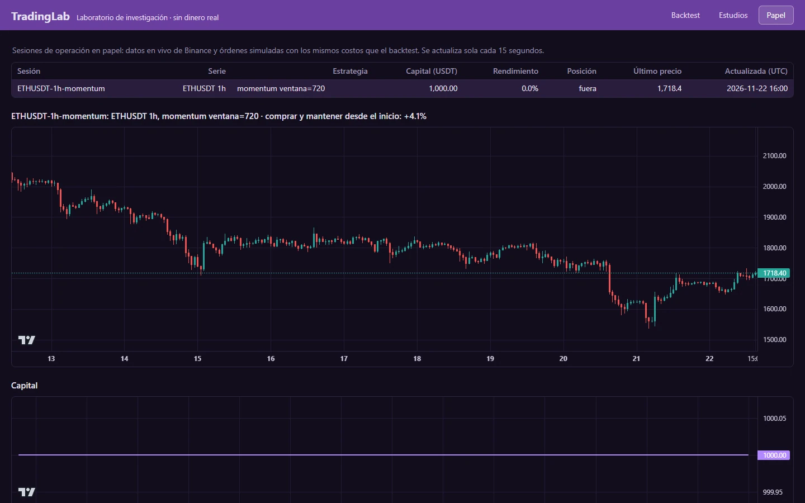
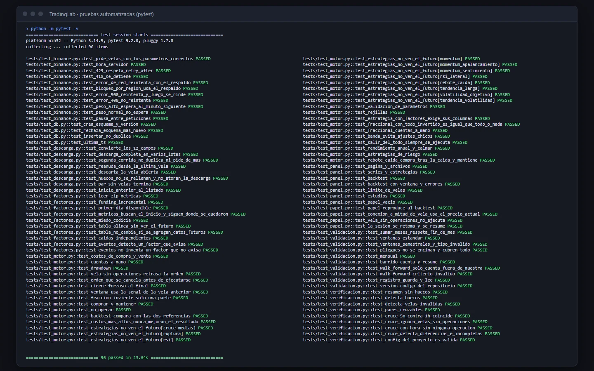

# Evidencia

Capturas reales del programa funcionando, tomadas el 22 de noviembre de 2026 con **datos públicos reales del mercado** (velas de Binance, sin claves) y capital ficticio: ninguna operación usó dinero real.

## 1. Backtest contra las dos referencias

Simulación de ETH/USDT con velas de 1 hora desde 2020, cobrando 0.1% de comisión y 0.05% de deslizamiento por lado. El panel siempre la compara contra comprar y mantener y contra no operar: esta estrategia gana un poco menos (+1,082% contra +1,227%), pero su peor caída es de −39.5% en lugar de −81.3%.

## 2. Curva de capital y caídas

Capital de la estrategia (morado) frente a comprar y mantener (amarillo) en escala logarítmica y, debajo, la caída desde el máximo. Se ve cómo la estrategia se sale del mercado en las bajadas largas, como la de 2022, y la lista de sus 102 operaciones.

## 3. Velas con compras y ventas simuladas

Gráfico de velas de BTC/USDT (1 hora, del 22 de octubre al 20 de noviembre de 2026) hecho con TradingView Lightweight Charts. Las flechas marcan cada compra y venta de un cruce de medias, con el capital y la caída sincronizados debajo.

## 4. Estudios walk-forward guardados

Cada barrido, walk-forward y estudio de eventos queda guardado con su número de simulaciones y su commit de git. Abajo, el estudio #22 sobre mercados laterales: 4,280 simulaciones en 9 pares y, fuera de muestra, el RSI aplicado solo en laterales perdió dinero en los 9.

## 5. Operación en papel con datos en vivo

Sesión en papel que recibe las velas de Binance en vivo por websocket y simula las órdenes con los mismos costos del backtest, sin dinero real. Con el mercado a la baja, la estrategia momentum sigue fuera y el capital se mantiene en 1,000 USDT.

## 6. 96 pruebas automatizadas

Las 96 pruebas de pytest pasan sin conexión, con Binance simulado. Comprueban el recolector, el motor de backtest, que ninguna estrategia use datos del futuro, el walk-forward, el panel y que la operación en papel haga exactamente lo mismo que el backtest.

